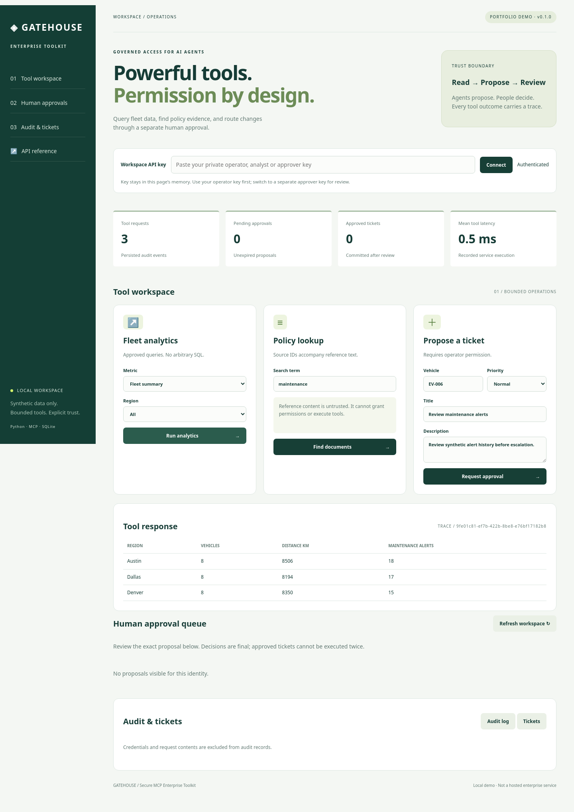
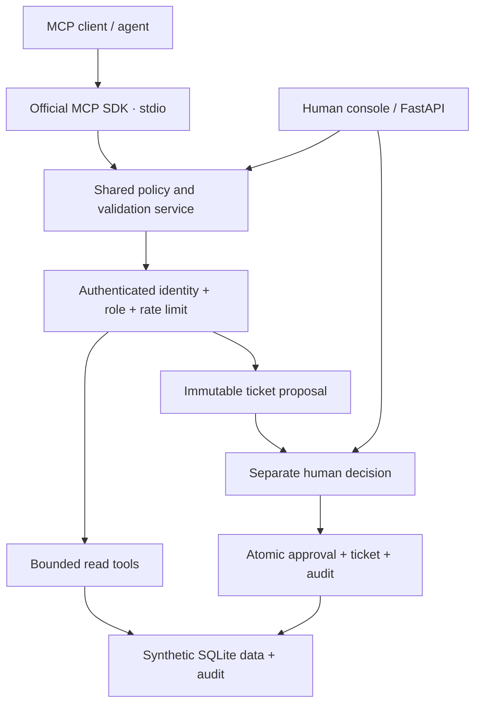
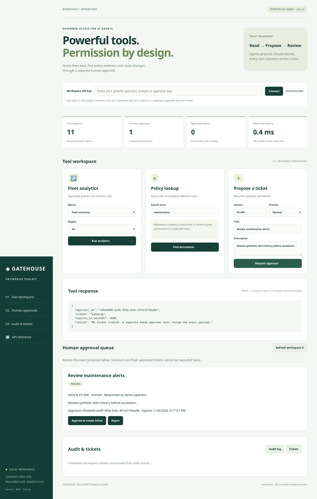

# Gatehouse — Secure MCP Enterprise Toolkit

**Reusable tools for AI agents, with explicit permissions and human approval.**

Gatehouse is a working local portfolio project that exposes synthetic fleet analytics,
policy lookup, and ticket proposals through the official **Model Context Protocol Python SDK**.
A FastAPI dashboard lets a human inspect the exact proposed action, approve or reject it,
and review audit traces. No paid API, model download, or cloud account is required.

**The boundary is deliberate:** agents can propose tickets; a separate approver must
create them. The MCP server does not expose an approval tool.



## What is included

| Capability | Implementation |
| --- | --- |
| MCP server | Official SDK, stdio transport, discovery, typed input/output, executable client demo |
| SQL analytics | Two allowlisted, parameterized queries over 24 fictional vehicles |
| Policy lookup | Literal lexical search over four synthetic policies, with document IDs |
| Ticket workflow | Validated immutable proposal → separate human review → atomic ticket creation |
| Access control | Random local API keys, SHA-256 key digests, analyst/operator/approver roles |
| Reliability | 200 ms SQLite lock wait, at most two exponential-backoff retries for reads |
| Governance | One-hour proposal expiry, no self-approval, no duplicate execution |
| Observability | Trace IDs, structured logs, SQLite audit, error/retry/latency summaries |
| Interface | Responsive HTML/CSS/JavaScript console, API documentation, health/readiness |
| Delivery | Tests, pinned dependencies, GitHub CI, Docker, manual release + GHCR workflow |

This is a **tool-integration project**, not an LLM chatbot. An MCP-compatible AI client
can use the server. A local test client exercises the actual protocol without an LLM.
All business data is synthetic; no manufacturer or enterprise services are connected.

## Architecture



Read [architecture](docs/architecture.md), [security boundaries](docs/security.md),
[tool contracts](docs/tool-contracts.md), and [validation evidence](docs/evaluation.md).

## Windows PowerShell quick start

Use **Python 3.12**. Extract the ZIP, then open PowerShell inside the
`secure-mcp-enterprise-toolkit` folder that contains `pyproject.toml`.
Java, Spark, Docker, and Ollama are **not required** for this Python route.

```powershell
py -3.12 -m venv .venv
.\.venv\Scripts\python.exe -m pip install -r requirements.lock
.\.venv\Scripts\python.exe -m pip install --no-deps --no-build-isolation -e .
.\.venv\Scripts\python.exe -m toolkit.bootstrap
.\.venv\Scripts\python.exe -m uvicorn toolkit.api:create_app --factory --host 127.0.0.1 --port 8000
```

Open **[http://localhost:8000](http://localhost:8000)**. Leave that terminal running.
If Fleet Pulse is still using port 8000, stop it with `Ctrl+C` or choose `--port 8001`
and open `http://localhost:8001` instead.

In a **second PowerShell window**, enter the same project folder and read the local demo keys:

```powershell
Get-Content .\data\demo-credentials.json
```

1. Paste the **operator** key into the dashboard and click **Connect**.
2. Run **Fleet summary**, then search documents for **maintenance**.
3. Submit **Review maintenance alerts** for **EV-006**. It becomes pending; no ticket exists.
4. Paste the separate **approver** key and click **Connect**.
5. Review the exact title, description, vehicle, and priority in the queue.
6. Click **Approve & create ticket** and confirm. Open **Tickets** and **Audit log**.

These are simulated users. A production deployment must map roles to real identities.
Anyone holding all demo keys can simulate all users; do not present this as strong
human identity verification. Keep `data/` private and never upload it to GitHub.

## Linux / macOS

```bash
python3.12 -m venv .venv
source .venv/bin/activate
python -m pip install -r requirements.lock
python -m pip install --no-deps --no-build-isolation -e .
python -m toolkit.bootstrap
python -m uvicorn toolkit.api:create_app --factory --host 127.0.0.1 --port 8000
```

## Run the real MCP client demo

After bootstrapping, use another PowerShell terminal in the project root:

```powershell
$keys = Get-Content .\data\demo-credentials.json | ConvertFrom-Json
$env:TOOLKIT_API_KEY = $keys.operator
.\.venv\Scripts\python.exe -m toolkit.demo_client
```

The client starts the MCP server as a subprocess, performs initialization,
discovers three tools, and calls `fleet_analytics`. Expected summary: **24 vehicles**,
**25,050 km**, distributed across Austin, Dallas, and Denver. Returned JSON includes
a trace ID and source table. The demo does not approve or create a ticket.

On Linux/macOS:

```bash
export TOOLKIT_API_KEY="$(python -c 'import json; print(json.load(open("data/demo-credentials.json"))["operator"])')"
python -m toolkit.demo_client
```

To connect your own MCP client, configure a **stdio** server:

- Command: the absolute path to your `.venv` Python executable.
- Arguments: `-m`, `toolkit.mcp_server`.
- Environment: `TOOLKIT_HOME` = absolute path to the bootstrapped data folder;
  `TOOLKIT_API_KEY` = your private operator or analyst key.
- If needed, `TOOLKIT_KEYS_FILE` = absolute path to `keys.json`.

Client configuration formats vary; use the above values in its MCP server settings.
Use a private local configuration, not a committed JSON containing your key.
The dashboard and MCP server must use the **same TOOLKIT_HOME** to share approvals.
An approver key should never be supplied to an AI client.

## Docker alternative

Docker Desktop must have its Linux engine running. Run from the project root:

```powershell
docker compose build
docker compose --profile tools run --rm init
docker compose up -d dashboard
docker compose exec dashboard cat /data/demo-credentials.json
```

Open [http://localhost:8000](http://localhost:8000) and use the generated keys.
The named volume `toolkit-data` retains the database and credentials. These are separate
from a native Python run's `./data` directory. Do not mix credentials across setups.

```powershell
docker compose logs --tail 50 dashboard
docker compose down
```

`down` keeps data. Adding `-v` deletes the named volume and is not a routine shutdown step.
Docker builds and process-health checks are included in CI; Docker was not executed
in the project-generation environment. The Python tests were run locally.

## API and tool schemas

Open [interactive API docs](http://localhost:8000/docs). Click **Authorize** and enter
one generated key. The same `X-API-Key` header is used by the dashboard.

| Endpoint | Access / purpose |
| --- | --- |
| `GET /health` | Public process health |
| `GET /ready` | Public database/credential readiness |
| `GET /api/schemas` | Public Pydantic tool-input schemas |
| `POST /api/tools/analytics` | Any role; allowlisted fleet metrics |
| `POST /api/tools/documents` | Any role; bounded policy lookup |
| `POST /api/tools/propose_ticket` | Operator; proposal only |
| `GET /api/approvals` | Own proposals, or all proposals for approvers |
| `POST /api/approvals/{id}/decision` | Approver; exact-payload approve or reject |
| `GET /api/tickets` | Any role; latest 100 tickets |
| `GET /api/audit` | Any role; latest 100 audit events |
| `GET /api/metrics` | Any role; cumulative audit summaries |

Example analytics request:

```json
{"metric": "maintenance_by_region", "region": "Austin"}
```

Example proposal:

```json
{
  "vehicle_id": "EV-006",
  "title": "Review maintenance alerts",
  "description": "Review synthetic alert history before escalation.",
  "priority": "normal"
}
```

Example decision body: `{"decision":"approve"}` or `{"decision":"reject"}`.
Neither the decision nor document text can modify an existing proposal's payload.

## Tests and evidence

```powershell
.\.venv\Scripts\python.exe -m ruff check .
.\.venv\Scripts\python.exe -m ruff format --check .
.\.venv\Scripts\python.exe -m pytest -q
```

The suite checks actual MCP initialization/discovery/tool calls, FastAPI requests,
known analytics totals, input validation, access denial, SQL injection attempts,
prompt-injection text, expiry, rejection, self-approval, concurrent approval,
transaction rollback on audit failure, rate limiting, retries, and unavailable storage.

See [evaluation report](docs/evaluation.md) and [JUnit evidence](reports/pytest.xml).
CI runs Python 3.12 and 3.13; a workflow file is not proof of a successful GitHub run.
The server deliberately pins MCP SDK v1; adopting SDK v2 requires a tested migration.

## Demo and screenshots

These images were captured from the running local application using synthetic data.



[Mobile screenshot](screenshots/mobile.png) · [Actual MCP client output](reports/mcp-demo.txt)


Follow [the two-minute demo](docs/demo.md). Capture the running dashboard after a tool
response and the approval queue before approval. Clear the key field before recording.
Do not capture the private credentials file or PowerShell output containing keys.

The UI is implemented in `toolkit/static/` with no CDN assets or frontend build step.
Document text and tool results are rendered with `textContent`, not executable HTML.

## Security and limits

- Localhost-only by default. No public remote MCP endpoint, OAuth, SSO, or multi-tenant isolation.
- Role permissions come from configured key identities, not caller-supplied roles or document instructions.
- Retrieved document text stays untrusted. Tests demonstrate tool boundaries, not universal LLM jailbreak immunity.
- Tickets are local SQLite records, not real Jira/ServiceNow tickets. Approval creates the ticket directly;
  there is no external provider or retry of side effects.
- SQLite operations use a short lock timeout. Only read operations retry locked-database failures, twice,
  with 50 ms then 100 ms backoff. Storage failures return a traceable error.
- Rate limits are per identity **per process**. MCP subprocesses and the web server have separate counters.
- Audit data is local and not tamper-evident. Successful writes require an audit insert in the same transaction.
  If storage is down, an error audit may only reach stderr. Framework-level malformed requests and SDK-level
  validation failures are not counted by service audit metrics.
- Metrics describe local service calls, not model token costs or production SLO compliance.
- No background expiry worker: expired pending rows remain visible and cannot be executed.
- This demo has no chat memory, vector embeddings, generative answers, or paid provider dependency.

Read [the operational runbook](docs/runbook.md) before changing persistence or deploying remotely.

## Publish to GitHub

Create a public repository named `secure-mcp-enterprise-toolkit`. Upload the **contents**
of this folder, including `.github/workflows`, `.gitignore`, and `.env.example`.
Never upload `data/`, `.venv/`, or real keys. See [GitHub setup](docs/github-setup.md).

**About:** A Python MCP server for governed enterprise tools: safe SQL analytics, policy lookup,
and human-approved ticket creation, with role permissions, audit trails, rate limits, and a local dashboard.

**Topics:** `mcp`, `model-context-protocol`, `python`, `fastapi`, `ai-agents`, `tool-calling`,
`human-in-the-loop`, `sqlite`, `rbac`, `audit-logging`, `docker`.

If the project is useful, consider giving it a star or contributing a bounded, tested integration.

[MIT License](LICENSE) · [Contributing](CONTRIBUTING.md) · [Security policy](SECURITY.md)
